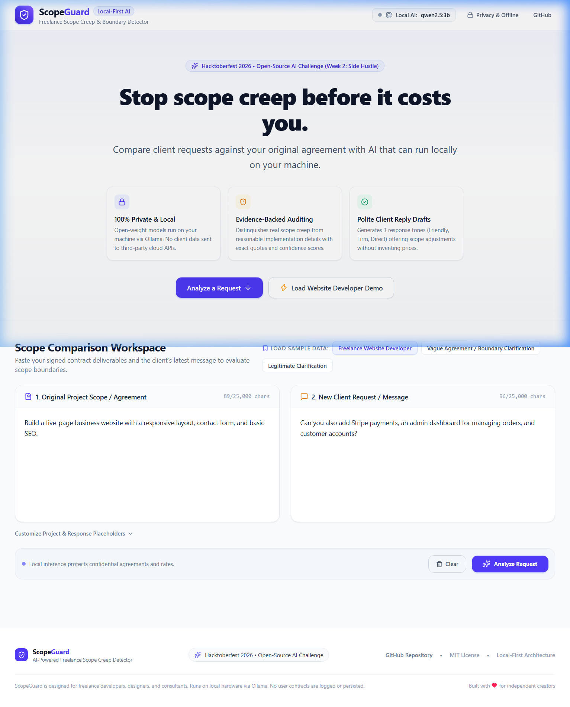
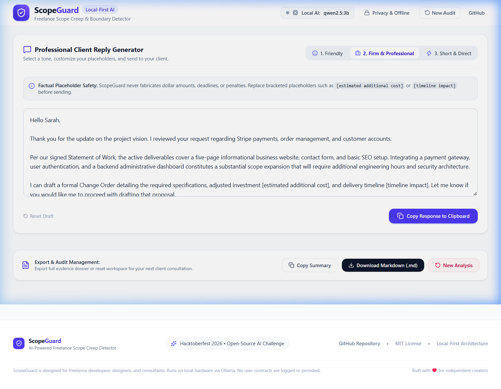
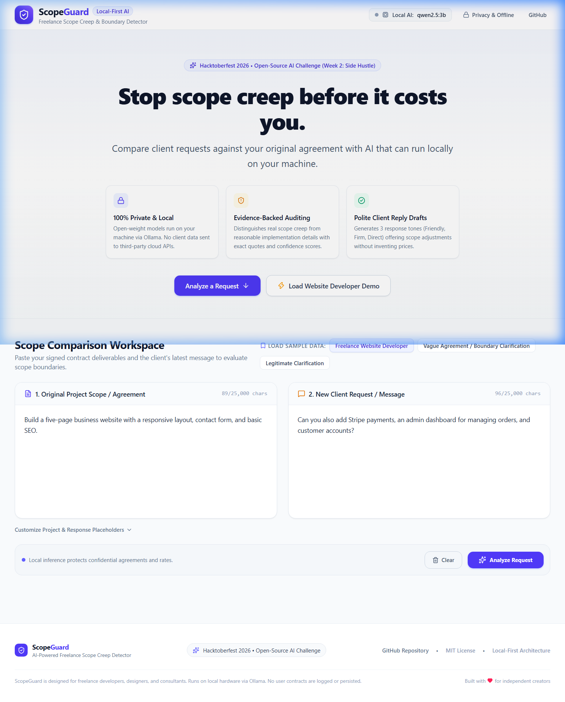
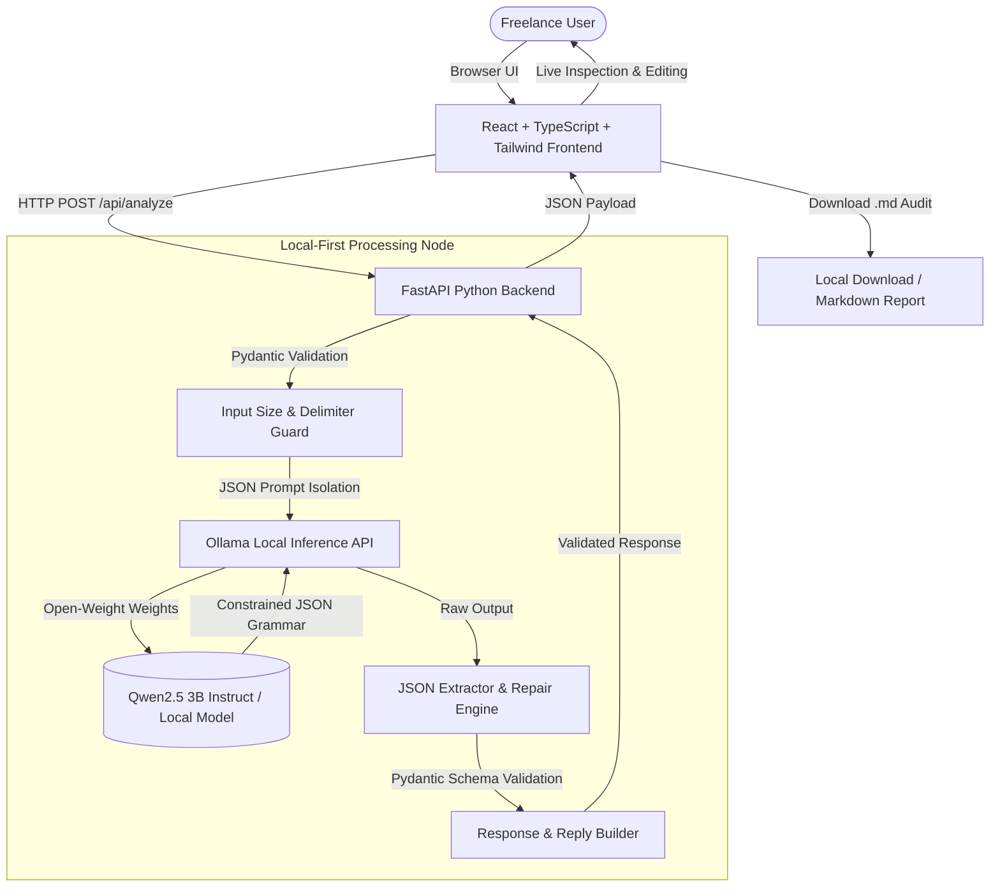

# ScopeGuard 🛡️

**AI-Powered Freelance Scope Creep Detector**  
*Built for the Hacktoberfest 2026 Open-Source AI Challenge (Week 2: Side Hustle)*

> *"Protect your time, catch scope creep early, and handle difficult client conversations professionally."*

[](LICENSE)
[](https://python.org)
[](https://fastapi.tiangolo.com)
[](https://react.dev)
[](https://www.typescriptlang.org)
[](https://ollama.com)
[](https://lalit-oli-mohan-479.github.io/ScopeGuard/)

> 🌐 **Live Web Application & Interactive Demo:** **[https://lalit-oli-mohan-479.github.io/ScopeGuard/](https://lalit-oli-mohan-479.github.io/ScopeGuard/)**  
> *(Experience the interactive scope analysis, reply drafts, and report generator directly in your browser without local setup!)*

---

## The Problem ScopeGuard Solves

Freelance software engineers, UI/UX designers, copywriters, and consultants frequently encounter **scope creep**—the gradual expansion of project requirements without corresponding adjustments to budget, timeline, or contractual terms.

Scope creep rarely arrives as an aggressive demand. It almost always sneaks in as innocent requests:
- *"Could you also connect Stripe checkout?"*
- *"Can we just add an admin dashboard for orders?"*
- *"While you're in there, could we set up customer accounts?"*

Freelancers often struggle to navigate these conversations:
1. **People-Pleasing & Imposter Syndrome:** Independent creators fear that flagging extra work will damage client goodwill.
2. **Ambiguity & Vague Contracts:** Handshake scopes or vague phrases like *"basic SEO"* make it difficult to determine whether an audit across 40 landing pages is included or out of scope.
3. **Drafting Anxiety:** Writing polite, firm pushback emails takes emotional energy and billable time.

**ScopeGuard** is a local-first AI assistant that compares client requests directly against original statements of work (SOWs). It isolates contract boundaries, highlights exact evidence quotes, calculates confidence ratings, distinguishes between legitimate clarifications and major scope expansions, and automatically drafts 3 customizable client responses (Friendly, Firm, Direct) with safety placeholders.

---

## Screenshots

| Scope Comparison Workspace | Evidence-Backed Results Dashboard |
| :---: | :---: |
|  |  |
| *Dual editor with character counters and preset scenarios* | *Color-coded findings (Emerald, Amber, Slate) with confidence scores* |

| Professional Reply Generator | Local AI & Privacy Architecture |
| :---: | :---: |
|  |  |
| *3 editable reply tones with factual placeholders* | *Zero cloud transmission & in-memory confidentiality* |

---

## Core Features

- **🛡️ 100% Local Open-Weight Inference:** Runs entirely on your local machine using [Ollama](https://ollama.com) (default: `qwen2.5:3b`). Client agreements, NDAs, and rates never leave your computer.
- **🔍 Evidence-Backed Findings:** Pinpoints exact excerpts from both the client request and the original contract agreement.
- **⚖️ Nuanced Boundary Classification:**
  - `included`: Reasonably implied tasks, bug fixes, or deliverables explicitly in scope.
  - `potentially_out_of_scope`: Major new features, third-party payment gateways, auth portals, or mobile conversions.
  - `uncertain`: Ambiguous contract terms where neither inclusion nor exclusion can be proved; recommends clarification instead of making false contractual accusations.
- **✉️ 3 Editable Client Response Drafts:**
  1. *Friendly & Collaborative:* Enthusiastic tone proposing Phase 2 add-ons.
  2. *Professional & Firm:* Standard corporate change order language citing agreed deliverables.
  3. *Short & Direct:* Crisp 2-paragraph reply for agile client communications.
- **🔒 Anti-Hallucination Placeholder Safety:** Never fabricates prices, deadlines, or legal penalties. Generates structured bracketed placeholders (`[estimated additional cost]`, `[timeline impact]`).
- **📥 Downloadable Markdown Report:** Export full evidence audits as `.md` files for client files or dispute documentation.
- **⚡ Built-in Demo Scenarios:** Includes the official Hacktoberfest website developer demo (5-page website vs. Stripe/Dashboard/Accounts), plus edge cases for vague contracts and legitimate clarifications.

---

## Architecture Diagram



---

## Why Open-Weight AI Matters for Freelancers

ScopeGuard was deliberately built on local open-weight AI rather than proprietary cloud APIs:

1. **Client Confidentiality & NDAs:** Freelance contracts, fee schedules, and proprietary feature ideas are legally sensitive. Sending client contracts to cloud API providers risks violating non-disclosure agreements. Running locally guarantees zero cloud data transmission.
2. **Model Choice & Hardware Autonomy:** Users can run small 3B models on lightweight laptops (`qwen2.5:3b`, `llama3.2:3b`) or larger models (`qwen2.5:7b`, `mistral:7b`) on dedicated GPUs.
3. **Zero Recurring Overhead:** Independent contractors should not need monthly subscriptions or per-token API bills just to evaluate client emails.
4. **Honest Limitations:** While local 3B models offer privacy and zero marginal cost, they require local RAM/VRAM (~3-4 GB) and cannot replace legal counsel. ScopeGuard flags uncertainty rather than pretending to provide binding legal advice.

---

## Prerequisites

- **Python:** 3.10 or higher (Python 3.13 tested)
- **Node.js:** 18 or higher (Node v24 tested) & npm
- **Ollama:** Download from [ollama.com](https://ollama.com)

---

## Quickstart & Local Setup

### Step 1: Install Ollama & Pull the Model

1. Install Ollama from [ollama.com](https://ollama.com/download).
2. Pull and start the recommended model:

```bash
# Download and test the recommended model
ollama run qwen2.5:3b
```

*(You can also use `llama3.2:3b` or `qwen2.5:7b` by setting `OLLAMA_MODEL` in `.env`)*

### Step 2: Clone the Repository & Install Dependencies

```bash
git clone https://github.com/lalit-oli-mohan-479/ScopeGuard.git
cd scopeguard

# 1. Install Backend Dependencies
pip install -r backend/requirements.txt

# 2. Install Frontend Dependencies
cd frontend
npm install
cd ..
```

### Step 3: Run ScopeGuard

You can start both backend and frontend servers simultaneously using our launcher script:

```bash
python run_scopeguard.py
```

Or run them in separate terminal windows:

**Terminal 1 (Backend API):**
```bash
uvicorn backend.app.main:app --host 127.0.0.1 --port 8000 --reload
```

**Terminal 2 (Frontend UI):**
```bash
cd frontend
npm run dev
```

Open your browser at **`http://localhost:5173`**.

---

## Environment Variables

Copy `.env.example` to `.env` in the root directory:

```bash
cp .env.example .env
```

| Variable | Default | Description |
| :--- | :--- | :--- |
| `OLLAMA_BASE_URL` | `http://localhost:11434` | URL of the local Ollama daemon |
| `OLLAMA_MODEL` | `qwen2.5:3b` | Open-weight instruction model name |
| `OLLAMA_TIMEOUT_SECONDS` | `90.0` | Inference timeout in seconds |
| `MAX_INPUT_CHARS` | `25000` | Maximum character limit for inputs |
| `MIN_INPUT_CHARS` | `10` | Minimum character limit for inputs |

---

## API Endpoints

### `GET /api/health`
Checks Ollama connectivity, lists installed models, and verifies whether the configured model is available.

**Response:**
```json
{
  "status": "healthy",
  "ollama_connected": true,
  "ollama_url": "http://localhost:11434",
  "configured_model": "qwen2.5:3b",
  "model_available": true,
  "available_models": ["qwen2.5:3b:latest"],
  "error_message": null,
  "setup_command": null
}
```

### `POST /api/analyze`
Analyzes client request against original agreement.

**Request:**
```json
{
  "original_scope": "Build a five-page business website with a responsive layout, contact form, and basic SEO.",
  "client_request": "Can you also add Stripe payments, an admin dashboard for managing orders, and customer accounts?",
  "project_title": "Five-Page Business Website",
  "freelancer_name": "Alex",
  "client_name": "Sarah"
}
```

### `GET /api/demo`
Returns preset sample scenarios and verified reference analysis for instant testing.

---

## Running Tests

### Backend Unit Tests (Pytest)
Tests JSON extraction, prompt injection defense, edge case classifications, and ambiguous agreement handling:

```bash
pytest tests/test_backend.py -v
```

### Frontend Tests (Vitest)
Tests markdown report formatting and UI workspace validation:

```bash
cd frontend
npm run test
```

### Running All Tests
```bash
npm test
```

---

## Privacy & Security Architecture

1. **Prompt Injection Defense:** User text inside `original_scope` and `client_request` is wrapped in isolated XML boundary tags (`<original_scope>`, `<client_request>`). System instructions explicitly command the model to ignore embedded instructions.
2. **In-Memory Volatility:** No contracts, emails, or rates are written to a database or local log files. Documents disappear from RAM once analysis completes.
3. **No Cloud Leakage:** ScopeGuard never silently falls back to remote cloud AI APIs. If Ollama is offline, it provides clear setup instructions.

---

## Known Limitations

- **Hardware Dependency:** Inference speed depends on host CPU/GPU performance. On older dual-core CPUs, inference can take 15-30 seconds.
- **Contract Complexity:** ScopeGuard is an assistive productivity tool for freelance agreements, not a licensed attorney. Complex multi-state master services agreements (MSAs) with indemnification clauses require professional legal review.
- **Initial Setup:** Running locally requires downloading ~2 GB of model weights on first install.

---

## Future Roadmap

- [ ] PDF and DOCX contract upload parsing (local client-side extraction).
- [ ] Multi-turn email reply negotiation thread assistant.
- [ ] Rate and milestone calculator to convert scope creep into suggested hourly/fixed quotes.
- [ ] Fine-tuned LoRA adapter specifically trained on freelance scope dispute resolutions.

---

## Hacktoberfest 2026 Submission Summary

- **Challenge:** Hacktoberfest 2026 Open-Source AI Challenge, Week 2: Side Hustle
- **Project Name:** ScopeGuard
- **Repository Topics:** `hacktoberfest`, `open-source-ai`, `freelance`, `scope-creep`, `ollama`, `fastapi`, `react`, `local-ai`, `qwen2-5`
- **License:** MIT License
- **Author:** Lalit Mohan Oli ([@lalit-oli-mohan-479](https://github.com/lalit-oli-mohan-479))
